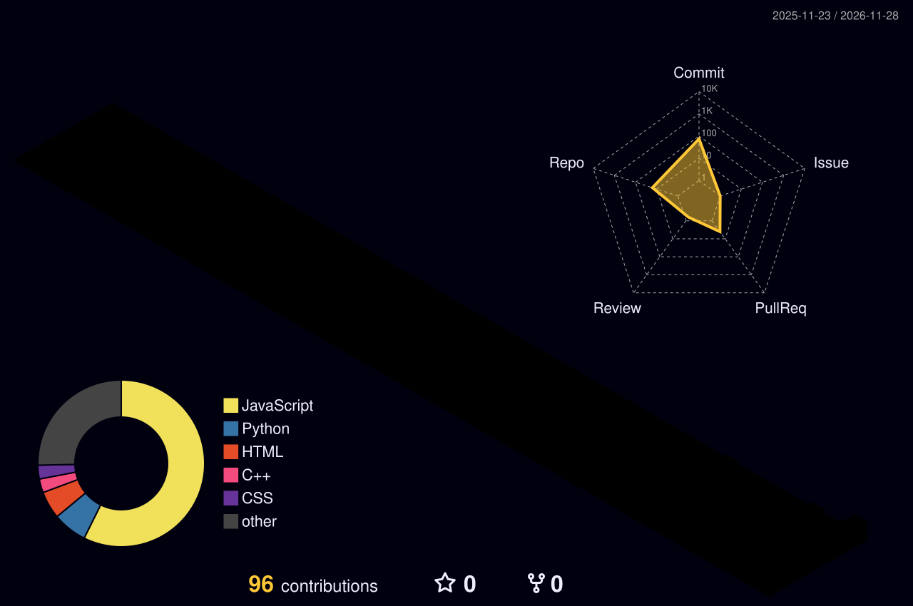

<!-- Hero Section -->

  

  

   

  <!-- Status & Info Badges -->
  
  
  

    

  <!-- Animasi Coding di Tengah (Atas About Me) -->
  

### 🚀 About Me

> *"Turning ideas into functional web applications, cross-platform mobile apps, and smart IoT prototypes."*

* 🎓 Undergraduate Informatics student at **Universitas PGRI Semarang (UPGRIS)**.
* 💻 Experienced in building **Full-Stack Web Apps** (Golang, Node.js, Nuxt.js, PHP), **Mobile Apps (Flutter)**, and **ESP32 IoT Systems**.
* 🌱 Passionate about backend architecture, mobile UI/UX, spatial data visualization (GIS), and computer networking.
* 📍 Based in **Semarang & Pekalongan, Central Java**.

---

### 🔥 GitHub Streak Stats

  

---

### 🏙️ 3D Isometric Contribution City

  

---

### 🕹️ Contribution Arcade (Pac-Man & Snake)

  
   
  

---

### 📈 GitHub Activity Graph

  

---

### 💻 Technologies & Tools

**Programming, Mobile & Frontend:**  

**Backend & Databases:**  

**GIS, Hardware IoT & Tools:**  

---

### 📂 Projects & Academic Works

  
<b>🌐 1. Web & Mobile Development</b>

  * 🎓 **University LMS Backend API**    
    *RESTful backend architecture using Express, Prisma ORM, and PostgreSQL on Supabase.*
  * 🛒 **REST API E-Commerce**    
    *Full-stack e-commerce platform powered by Go Gin Framework and Nuxt.js.*
  * 🕵️‍♂️ [**Personal Portfolio Website**](https://github.com/Luthfi1006/WEB-Portofolio)    
    *Dark neon-blue developer portfolio featuring an interactive security-puzzle welcome gate.*
  * 🚗 **Vehicle Selection DSS (SAW)**   
    *Decision Support System utilizing the Simple Additive Weighting algorithm to rank used cars.*
  * 🔐 **PHP & MySQL Authentication System**    
    *Dynamic user registration, login, and password recovery system.*
  * 🏝️ **KKL Informatika UPGRIS 2026**   
    *Information portal for university field study activities in Bali.*
  * 🎆 **Interactive Birthday Letter**   
    *Animated celebration web app with fireworks, background music, and photo galleries.*
  * 📚 **English Vocabulary Application**   
    *Vocabulary learning application with interactive favorite word management.*

  
<b>🗺️ 2. Geographic Information System (GIS)</b>

  * 📊 **Pekalongan Spatial & Student Distribution Analysis**    
    *Interactive spatial mapping and statistical analysis of population density and SLTP student distribution across 19 districts in Pekalongan Regency.*

  
<b>🤖 3. Internet of Things (IoT) & Embedded Systems</b>

  * 🐟 **Automated Milkfish (Bandeng) Sorter**    
    *Smart sorting prototype using ESP32, ultrasonic sensor, dual servo motors, Y-shaped PVC chute, and real-time Telegram reporting.*
  * 📦 **Telegram-Controlled Smart Drop Box**    
    *Secure package drop box powered by ESP32, relay module, and 12V solenoid door lock.*

  
<b>🐍 4. Python, OOP & Cryptography</b>

  * 🛡️ **Classical Cryptography Desktop Suite**    
    *Desktop GUI applications implementing Caesar Cipher, Vigenère Cipher, Double Transposition, and Myszkowski Transposition.*
  * 🚙 **Vehicle Collection Management System**   
    *Object-Oriented Programming application implementing inheritance, encapsulation, and polymorphism.*
  * 🔒 **SIAKAD Cybersecurity Case Study**   
    *Information system security audit and vulnerability analysis.*

  
<b>📡 5. Computer Networking</b>

  * 🏨 **Hotel Network Topology**   
    *Multi-floor enterprise network simulation and routing architecture.*
  * 🔀 **VLAN Network Segmentation**   
    *Department-based network segmentation design for PT Solusi Digital.*
  * 📶 **Wireless Network Architecture**   
    *Wireless networking concepts, access point placement, and security implementation studies.*

  
<b>📐 6. Software Engineering</b>

  * 📋 **CRM System Analysis**   
    *Requirements engineering, Use Case diagrams, User Stories, and SRS documentation.*
  * 📅 **Software Project Management**   
    *Work Breakdown Structure, RACI matrix, project scheduling, budgeting, and risk management.*
  * ⚙️ **SDLC & DevOps Studies**   
    *Comparative studies on Waterfall, Agile, DevOps, and software effort estimation.*

  
<b>🎨 7. Quality Assurance, UI/UX & Multimedia</b>

  * 💳 **ShopeePay QRIS Functional Testing**   
    *End-to-end functional testing scenarios and test case documentation.*
  * 🚌 **Trans Semarang UI/UX Evaluation**   
    *User interface heuristic evaluation and mobile usability analysis.*
  * ✨ **Shneiderman's Eight Golden Rules**   
    *Human-Computer Interaction and interface design principles study.*
  * 🎬 **OTP Security Awareness 2D Animation**   
    *Multi-scene public service announcement animation with character rigging and lip-sync.*

  
<b>💼 8. Business & Artificial Intelligence</b>

  * 🎮 **GASIST (Game Asisten)**   
    *Startup business model validation and canvas for a gaming assistance service.*
  * 🧠 **Intelligent Systems: Present & Future**   
    *Academic research paper exploring current and future intelligent system technologies.*

---

### 🎯 Goals
* 🚀 Improve programming and problem-solving skills.
* 📱 Build cross-platform mobile apps with Flutter and scalable full-stack web services.
* 🤖 Develop practical IoT hardware and software integrations.
* 📐 Master software engineering and quality assurance best practices.
* 💡 Contribute to impactful real-world technology projects.

---

### 📫 Connect With Me

  
  
  
  
  

 

⭐ <i>Thank you for visiting my GitHub profile!</i> ⭐

<!-- Footer Gelombang -->

